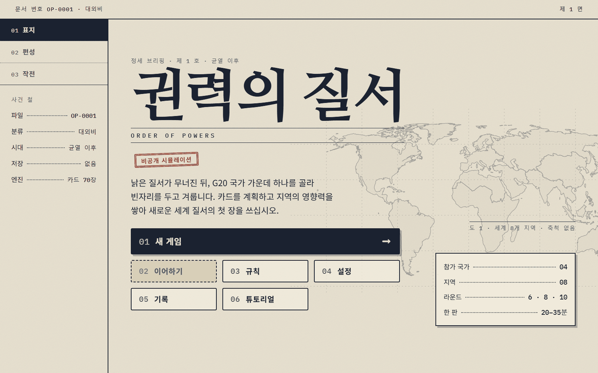
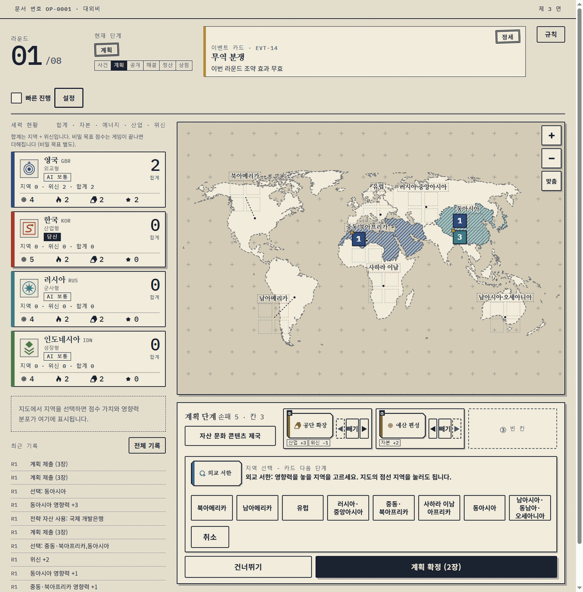
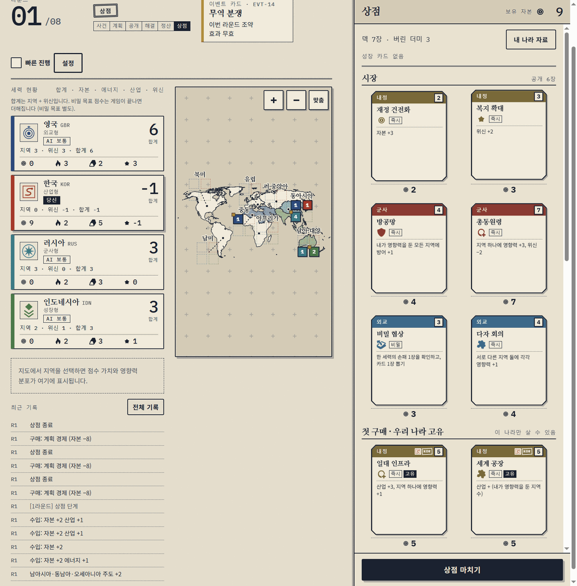
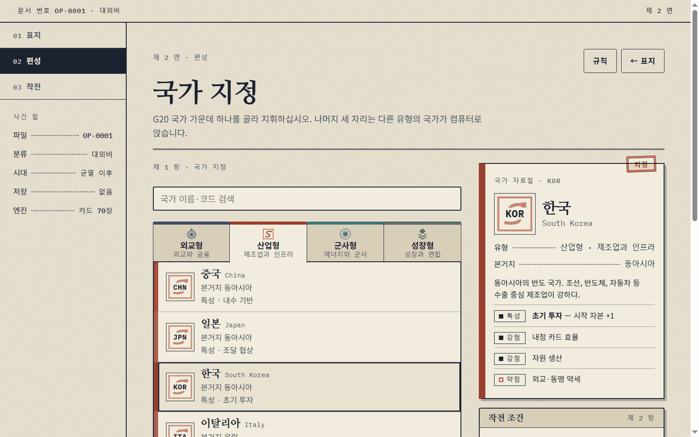
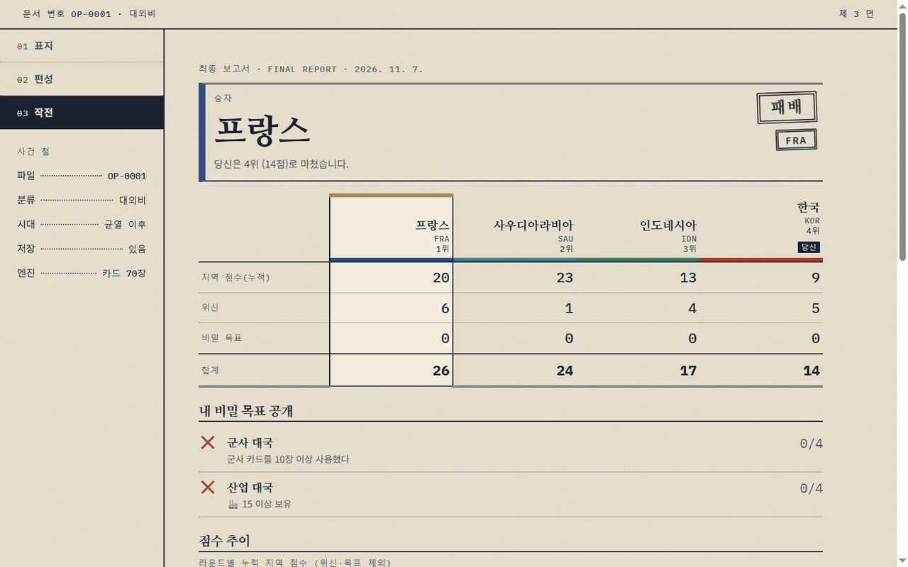
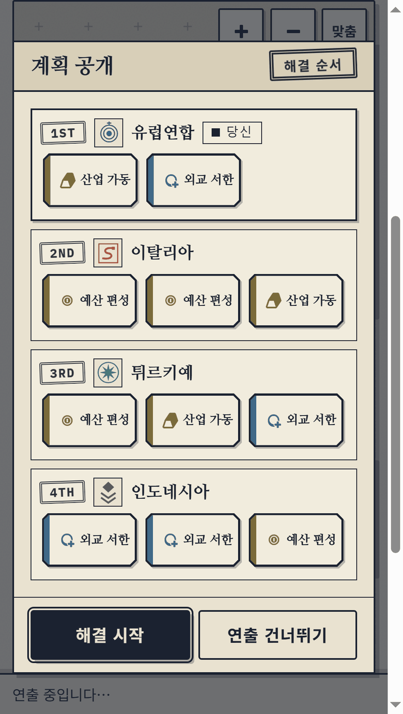
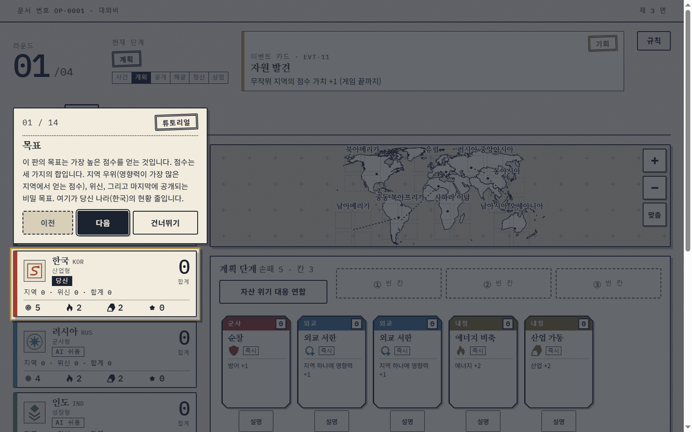
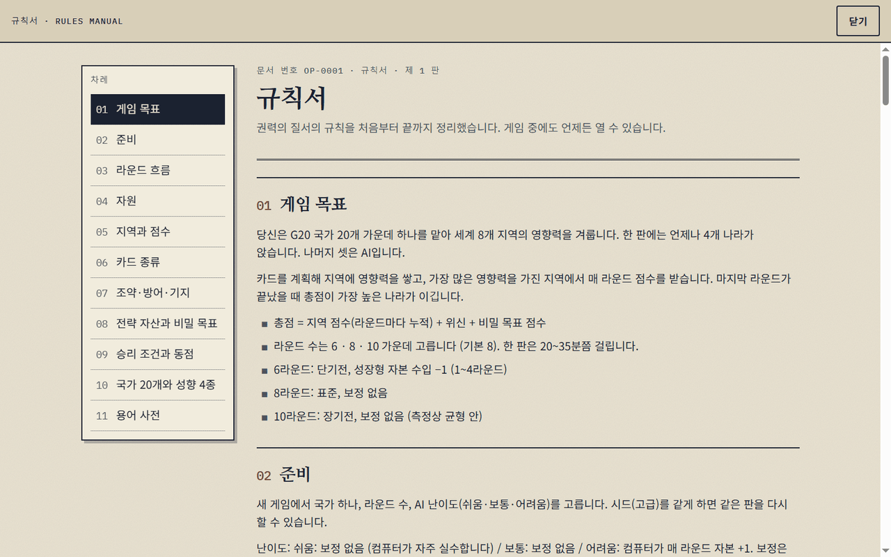

# 권력의 질서 (Order of Powers)

G20 국가 중 하나를 골라 세계 8개 지역의 영향력을 겨루는 웹 전략 보드게임입니다. 카드를 계획하고, 한꺼번에 공개하고, 순서대로 해결합니다. 설치나 빌드 없이 브라우저에서 한 판에 20~35분이 걸립니다.

**바로 플레이: <https://sigco3111.github.io/order-of-powers/>**



## 한눈에 보기

| 항목 | 내용 |
| --- | --- |
| 참가 | 4명 (플레이어 1명 + 컴퓨터 3명) |
| 국가 | G20 20개, 외교형·산업형·군사형·성장형 네 성향 |
| 판 길이 | 6 / 8 / 10 라운드 중 선택 (기본 8) |
| 컴퓨터 난이도 | 쉬움 / 보통 / 어려움 |
| 카드 | 70장, 성장 카드 10장, 전략 자산 12종, 비밀 목표 20종, 사건 20종 |
| 환경 | 정적 파일만 사용, 빌드 없음. 모바일(390px)에서도 플레이 가능 |
| 부가 기능 | 자동 저장·이어하기, 전적 기록, 업적, 튜토리얼, 규칙서, 고대비·글자 크기·움직임 줄이기·소리 설정 |

## 한 라운드의 흐름

한 라운드는 사건 → 계획 → 공개 → 해결 → 정산 → 상점 순으로 진행됩니다. 마지막 라운드가 끝나면 지역 점수, 위신, 비밀 목표를 합산해 승자를 정합니다.

| 단계 | 하는 일 |
| --- | --- |
| 사건 | 이번 라운드의 사건 카드가 공개되고, 전략 자산을 고릅니다. |
| 계획 | 손패에서 카드를 칸에 넣고, 영향력을 놓을 지역을 고릅니다. |
| 공개 | 모든 세력의 계획이 동시에 공개되고 해결 순서가 정해집니다. |
| 해결 | 순서대로 카드 효과가 적용됩니다. |
| 정산 | 지역 주도권에 따라 점수와 수입이 들어옵니다. |
| 상점 | 자본으로 새 카드와 성장 카드를 사서 덱을 키웁니다. |





| 편성 | 최종 보고서 |
| --- | --- |
|  |  |

| 모바일 (계획 공개) | 튜토리얼 | 규칙서 |
| --- | --- | --- |
|  |  |  |

## 국가와 성향

플레이할 국가를 고르면 나머지 세 자리는 다른 성향의 국가가 컴퓨터로 앉습니다. 국가마다 고유 특성이 하나씩 있습니다. 전체 표는 [docs/COUNTRIES.md](docs/COUNTRIES.md)에 있습니다.

| 성향 | 국가 |
| --- | --- |
| 외교형 | 유럽연합, 프랑스, 독일, 캐나다, 영국 |
| 산업형 | 중국, 일본, 한국, 이탈리아, 멕시코 |
| 군사형 | 러시아, 미국, 튀르키예, 사우디아라비아, 호주 |
| 성장형 | 인도, 인도네시아, 브라질, 남아프리카공화국, 아르헨티나 |

유럽연합은 국가가 아니라 공동체이지만 G20 구성원이어서 한 자리로 넣었습니다.

## 규칙 요약

- 이기는 쪽은 `지역 점수 + 위신 + 비밀 목표`의 합이 가장 큰 세력입니다.
- 지역 점수는 영향력이 가장 많은 지역에서 라운드마다 받습니다. 비밀 목표 점수는 게임이 끝나야 더해집니다.
- 자원은 자본·에너지·산업 세 가지입니다.
- 게임 안에서 규칙서를 언제든 열 수 있고, 4라운드 튜토리얼이 처음 한 판을 안내합니다.

자세한 내용은 [규칙서 docs/RULES.md](docs/RULES.md), [기획서 docs/GAME_DESIGN.md](docs/GAME_DESIGN.md), [규칙 결정 기록 docs/RULES_DECISIONS.md](docs/RULES_DECISIONS.md)를 보십시오.

## 난이도와 밸런스

난이도 설정은 [src/data/difficulty.json](src/data/difficulty.json)에 있습니다. 쉬움과 보통은 보정이 없고, 어려움은 컴퓨터에 라운드마다 자본 +1을 줍니다. 컴퓨터끼리 시뮬레이션해 승률을 재며, 측정 과정은 [docs/BALANCE_REPORT.md](docs/BALANCE_REPORT.md)에 기록했습니다.

측정값(표본 오차는 표본 수에 따라 대략 ±4~8%p)과 한계는 다음과 같습니다.

- 난이도 섞은 판 300판에서 승률은 어려움 41.7%, 보통 27.2%, 쉬움 4.0%였습니다.
- 어려움 1명 대 보통 3명은 26.7~28.0%로, 목표(30~36%)에 조금 못 미칩니다.
- 성향별 승률(보통 4명, 8라운드)은 군사형이 33~34%로 두 번 연속 앞섰습니다. 외교형은 20~23%, 성장형은 25~28%, 산업형은 16~20%였고, 산업형의 낮은 값은 표본 오차 안일 수 있습니다. 군사형 우세는 아직 조정하지 않았습니다.

## 개발

저장소 루트에서 실행합니다. 빌드 도구는 필요 없습니다.

```bash
python3 -m http.server 8000      # http://localhost:8000/ 접속
node --test                      # 엔진·AI·UI 모델 테스트 (Node 18+)
node tools/validate-data.js      # 게임 데이터 검증
node tools/simulate.js --games 200 --rounds 8 --levels hard,hard,hard,hard --seed 1   # AI 시뮬레이션
```

`node --test`는 186개 테스트 중 185개 통과, 1개 건너뜀(실패 0)으로 확인했습니다. 전체 실행에 5분 정도 걸립니다.

```
order-of-powers/
├─ index.html          # 진입점 (src/ui/app.js)
├─ src/
│  ├─ engine/          # 규칙 엔진
│  ├─ ai/              # 컴퓨터 상대
│  ├─ data/            # 카드·국가·사건 등 JSON
│  └─ ui/              # 화면
├─ assets/             # 그림·소리 (CC0)
├─ map/                # 지도 미리보기
├─ tests/              # 테스트
├─ tools/              # 데이터 검증, 시뮬레이션
└─ docs/               # 기획, 규칙, 밸런스, QA 기록
```

설계 문서: [ENGINE_DESIGN.md](docs/ENGINE_DESIGN.md), [UI_DIRECTION.md](docs/UI_DIRECTION.md), [CARDS.md](docs/CARDS.md), [CARDS_EXPANSION.md](docs/CARDS_EXPANSION.md), [map-preview.md](docs/map-preview.md).

## 크레딧과 저작권

- 그림, 소리, 지도는 CC0 또는 퍼블릭 도메인 자료입니다. 원본 라이선스 파일은 각 에셋 폴더에 있고, 전체 목록은 [docs/ASSETS.md](docs/ASSETS.md)에 있습니다. 게임 안 설정 화면의 크레딧과 같습니다.
- 효과음: [Kenney](https://kenney.nl) (Casino Audio, UI Audio, Interface Sounds, RPG Audio), OpenGameArt의 Snabisch (Win sound effect), Felis Chaus (Game Over - Bad chest SFX).
- 배경음악: OpenGameArt의 mishonis (Meadow Thoughts), Pro Sensory (Contemplation).
- 이 작품은 영감을 준 보드게임과 관련 없는 독립적인 창작물입니다. 규칙, 그림, 문구는 직접 만들었고 해당 게임의 회사나 제작자와 제휴하거나 승인받은 바 없습니다.


## 개발 이력

마일스톤별 기록은 `docs/`에 있습니다: [QA_Q1](docs/QA_Q1.md), [QA_Q2](docs/QA_Q2.md), [QA_M6](docs/QA_M6.md), [QA_F1](docs/QA_F1.md), [BALANCE_REPORT](docs/BALANCE_REPORT.md), [s2b_status](docs/s2b_status.md), [u3a_status](docs/u3a_status.md), [u3b_status](docs/u3b_status.md).
