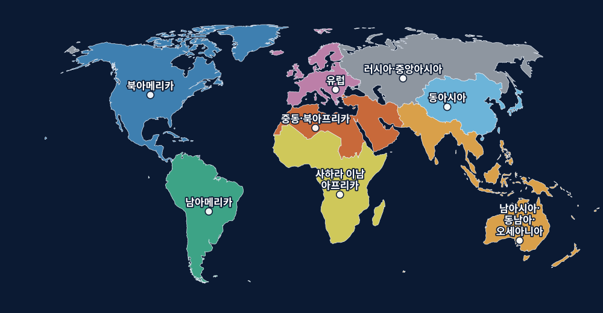

# 지도 미리보기

🗺 **라이브 미리보기(모바일 가능):** https://sigco3111.github.io/order-of-powers/map/
지역을 탭하면 점수 가치·영향력 칸·생산 자원·인접 지역을 볼 수 있고, "영향력 토큰 미리보기"로 토큰이 놓일 모습을 확인할 수 있습니다.

실제 세계 지도(Natural Earth, 퍼블릭 도메인)를 8개 지역으로 합친 지도입니다 ([assets/map/world-regions.svg](../assets/map/world-regions.svg)). 국경선·바다 이름·나라 이름은 없고, 각 지역의 원은 영향력 토큰 위치(마커)입니다. 만드는 법과 지역 구성은 [assets/map/README.md](../assets/map/README.md)를 참고하세요.

이전 추상 도형 초안은 [assets/map/regions.svg](../assets/map/regions.svg)에 참고용으로 남아 있습니다.
